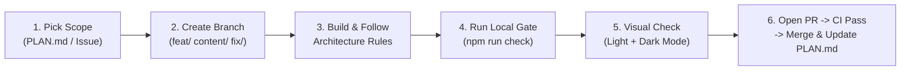

# Cognify — Development & Evolution Workflow

This playbook defines the repeatable workflow for building, expanding, verifying, and shipping **Cognify** as a web app today — while keeping the codebase cleanly structured for a future backend (accounts, cloud sync, AI proxy) or mobile/desktop app.

For the current phase-by-phase feature & curriculum roadmap, see [`PLAN.md`](./PLAN.md).

---

## 1. The Standard Development Loop

Every change — whether a new subject, upgraded notes, UI feature, or bug fix — follows the same 6-step loop:



### Step-by-Step

1. **Pick a small, focused slice**
   - Pull the next task from [`PLAN.md`](./PLAN.md) (e.g., 1–2 subjects or 1 UI feature per PR rather than giant multi-phase PRs).
   - If a task changes brand identity, persistence keys, or user-facing navigation, confirm the design before coding.

2. **Branch from up-to-date `main`**
   ```bash
   git checkout main && git pull
   git checkout -b feat/short-description      # UI or app feature
   # or: content/igcse-computer-science        # New/upgraded course content
   # or: fix/notes-timestamp-scroll            # Bug fix
   # or: chore/ci-and-tooling                  # Infra / scripts / docs
   ```

3. **Implement using Cognify's conventions** (see Sections 2–4 below).

4. **Run the local verification gate**
   ```bash
   npm run check                # Runs typecheck + test + production build
   ```
   If you edited any file in `src/data/courses/`, also verify YouTube links:
   ```bash
   npm run verify:youtube       # Verifies every youtubeId returns HTTP 200 via oEmbed
   ```

5. **Visual & interaction check (when touching UI, diagrams, or styles)**
   - Run `npm run dev` and inspect affected routes in **both Light and Dark mode**.
   - Check browser DevTools console for zero runtime errors and zero broken SVG/image assets.

6. **Commit, open a PR, and update tracking**
   - Push your branch and open a Pull Request against `main`.
   - Wait for GitHub Actions **CI** (and **YouTube Link Check** if course files changed) to pass.
   - Update [`PLAN.md`](./PLAN.md) once a milestone or phase is complete.

---

## 2. Curriculum & Content Workflow

Cognify's study workspace automatically generates complete quizzes, flashcards, cheat sheets, exam practice, and past papers via `ensureCompleteCourseContent` in [`src/data/contentCompleteness.ts`](./src/data/contentCompleteness.ts).

### Adding a New Subject

1. **Create the course module** under `src/data/courses/<qualification><Subject>.ts` exporting topics, notes, key terms, quizzes, flashcards, cheat sheets, exam practice, and past papers (or a `CourseContentBundle`).
2. **Match the Cognito-intuition note standard** (reference benchmark: `igbio-1-2` in [`src/data/courses/igcseBiology.ts`](./src/data/courses/igcseBiology.ts)):
   - `>= 2` note cards per subtopic (aim for 3 deep cards on A-Level topics).
   - Plain-English explanations structured with `subsections` (`heading`, `bullets`, `exampleHeading`, `examples`, optional `diagram`).
   - Lavender `glossaryPills`, `memoryAid`, and `commonMistake` callouts where helpful.
   - `>= 3` strictly ascending `timestamps` referencing valid `cardId`s.
   - Non-empty `checklistPoints` for the End-of-Notes active recall checklist.
3. **Select verified YouTube videos**:
   - Pick real video IDs from [`docs/yt_verified_pool.json`](./docs/yt_verified_pool.json) or channel/playlist Atom feeds (`https://www.youtube.com/feeds/videos.xml?channel_id=...`).
   - Never scrape `youtube.com/results` in loops.
   - Confirm every new `youtubeId` with `npm run verify:youtube`.
4. **Use registered diagrams only**:
   - Only use identifiers in `DiagramKind` ([`src/types/curriculum.ts`](./src/types/curriculum.ts)).
   - To add a new diagram: add the ID to `DiagramKind`, implement and export it in [`src/components/artwork/Diagrams.tsx`](./src/components/artwork/Diagrams.tsx), and add it to `VALID_DIAGRAM_KINDS` in [`src/__tests__/igcseAlevelNotes.test.ts`](./src/__tests__/igcseAlevelNotes.test.ts).
5. **Wire the subject into the app**:
   - Types: `SubjectIconId` in [`src/types/curriculum.ts`](./src/types/curriculum.ts) (if new icon needed).
   - Icons: [`src/components/artwork/SubjectIcons.tsx`](./src/components/artwork/SubjectIcons.tsx) + SVG asset in `public/assets/cognito/subject-badges/`.
   - Theme tokens: Light + Dark classes in [`src/styles/components.css`](./src/styles/components.css).
   - Catalog: register in [`src/data/catalog.ts`](./src/data/catalog.ts) (`IGCSE_SUBJECTS` / `ALEVEL_SUBJECTS`, `RAW_COURSES`, `getBoardsForQualification`, `getTiersForQualification`).
6. **Lock in coverage with tests**:
   - Add the new course ID(s) to [`src/__tests__/igcseAlevelNotes.test.ts`](./src/__tests__/igcseAlevelNotes.test.ts).

---

## 3. UI, Feature & Quality Guardrails

- **100% Paywall-Free Invariant**: Never introduce upgrade prompts, Pro locks, or weekly study caps. Protected by [`src/__tests__/paywallFree.test.tsx`](./src/__tests__/paywallFree.test.tsx).
- **Light & Dark Theme Parity**: Use CSS custom properties from [`src/styles/tokens.css`](./src/styles/tokens.css). Avoid hardcoded light-only colors in new components.
- **Key-Term Regression Guard**: Keep `"White blood cell"` uniquely matched in [`src/data/courses/biologyAqa.ts`](./src/data/courses/biologyAqa.ts) (see `sanitizeKeyTermDefinition` in [`src/data/contentCompleteness.ts`](./src/data/contentCompleteness.ts)).
- **Backward-Compatible Progress Storage**: Keep `localStorage` migration compatible with `STORAGE_KEY = 'cognito_clone_v1'` in [`src/store/AppContext.tsx`](./src/store/AppContext.tsx) so existing student XP, streaks, and notes progress are never wiped on update.

---

## 4. Staying Ready for Future Backend or App Expansion

Cognify stays **web-only right now**, with zero unnecessary complexity — while following four lightweight boundaries so adding a backend or mobile app later is clean and low-friction:

| Layer | Location | Rule | Why it pays off later |
| --- | --- | --- | --- |
| **Domain Types** | `src/types/` | Pure TypeScript interfaces/unions only; avoid React/DOM imports (`AvatarId` can be a string union in `types/`). | Shareable 1:1 with a backend API or mobile client. |
| **Curriculum Data** | `src/data/` | Pure, serializable data objects & pure builders. Zero `window`, `document`, `localStorage`, or JSX inside course files. | Can be moved to a CDN/API or bundled into an offline mobile package without rewriting content. |
| **Domain Logic** | `src/utils/`, `src/data/contentCompleteness.ts` | Pure functions (grading rubrics, completeness generation, session building). | Reusable across web, server-side grading, and mobile. |
| **State & Persistence** | `src/store/AppContext.tsx` | All persistence goes through one centralized store layer with schema `version` (`AppStoreState.version`). Never scatter raw `localStorage` calls inside pages/components. | Swap `localStorage` for a remote sync adapter (Supabase/Firebase/REST) in one place. |
| **UI Shell** | `src/pages/`, `src/components/` | Presentational & routing layer only; consume state via `useApp()` and data via `catalog.ts`. | Easy to wrap as a PWA/Capacitor app or build a parallel mobile UI later. |

### When You Are Ready to Expand Later
1. **Adding Accounts & Cloud Sync**: Extract `localStorage` read/write in `AppContext.tsx` into a `StorageAdapter` interface (`LocalStorageAdapter` default, `RemoteSyncAdapter` when signed in) and keep `AppStoreState.version` migrations deterministic.
2. **Adding Server-Side AI Marking**: Move optional AI marking requests behind a backend endpoint so API keys never live in client storage.
3. **Turning Into a Mobile/Desktop App**:
   - *Fastest path*: Add a Web App Manifest + Service Worker (PWA) or wrap `dist/` with Capacitor for iOS/Android.
   - *Native path*: Extract `src/types/`, `src/data/`, and `src/utils/` into a shared workspace package (`packages/core`) consumed by both web (`apps/web`) and native (`apps/mobile`).

---

## 5. Continuous Learning Automation & CI

Cognify runs an automated feedback loop so every pull request and every week measurably improves student learning depth:

### GitHub Actions Workflows
- **[`.github/workflows/ci.yml`](./.github/workflows/ci.yml)**: Runs on every push and PR to `main` (`npm ci`, `npm run typecheck`, `npm run test`, `npm run build`).
- **[`.github/workflows/learning-audit.yml`](./.github/workflows/learning-audit.yml)**: Runs `scripts/audit_learning_quality.mjs` on every push/PR (publishing the **Learning Quality Scorecard** to the GitHub Actions job summary) and weekly on Mondays to refresh a single tracked GitHub Issue listing the top P1/P2/P3 learning upgrades.
- **[`.github/workflows/youtube-check.yml`](./.github/workflows/youtube-check.yml)**: Runs `npm run verify:youtube` on PRs touching `src/data/courses/**`, weekly on Mondays, or manually via **Run workflow**.

### How the Continuous Improvement Loop Works
1. Run `npm run audit:learning` (or check [`docs/LEARNING_QUALITY_REPORT.md`](./docs/LEARNING_QUALITY_REPORT.md) / the weekly Learning Automation GitHub Issue).
2. Pick the top **P1** (unlock stub subject) or **P2** (deepen lowest-scoring lessons with subsections, worked examples, glossary pills, common mistakes, memory aids) item.
3. Implement the upgrade on a focused branch and run `npm run check`, `npm run verify:youtube`, and `npm run audit:learning:write`.
4. Confirm the **Learning Depth Score** increased, then open a PR using [`.github/pull_request_template.md`](./.github/pull_request_template.md).

### Hosting & Deployment (Static SPA)
Cognify builds to a static `dist/` folder (`npm run build`) deployable on Vercel, Netlify, Cloudflare Pages, or GitHub Pages.

> **Important**: Because Cognify uses `BrowserRouter`, configure an SPA fallback rewrite (`/* -> /index.html`, HTTP `200`) on your host so deep links like `/course/igcse-biology-cie/notes/igbio-1-2` work on page refresh.

---

## 6. Quick Command Reference

| Command | Purpose |
| --- | --- |
| `npm run dev` | Start Vite local development server |
| `npm run typecheck` | Run strict TypeScript check (`tsc --noEmit`) |
| `npm run test` | Run Vitest unit & curriculum integrity test suite |
| `npm run build` | Typecheck + production Vite bundle into `dist/` |
| `npm run check` | Full local CI gate (`typecheck` + `test` + `build`) |
| `npm run audit:learning` | Score pedagogical depth across all courses & print top next learning upgrades |
| `npm run audit:learning:write` | Refresh [`docs/LEARNING_QUALITY_REPORT.md`](./docs/LEARNING_QUALITY_REPORT.md) |
| `npm run verify:youtube` | Verify all `youtubeId` values return HTTP `200` via YouTube oEmbed |
| `npm run preview` | Preview the production `dist/` bundle locally |
